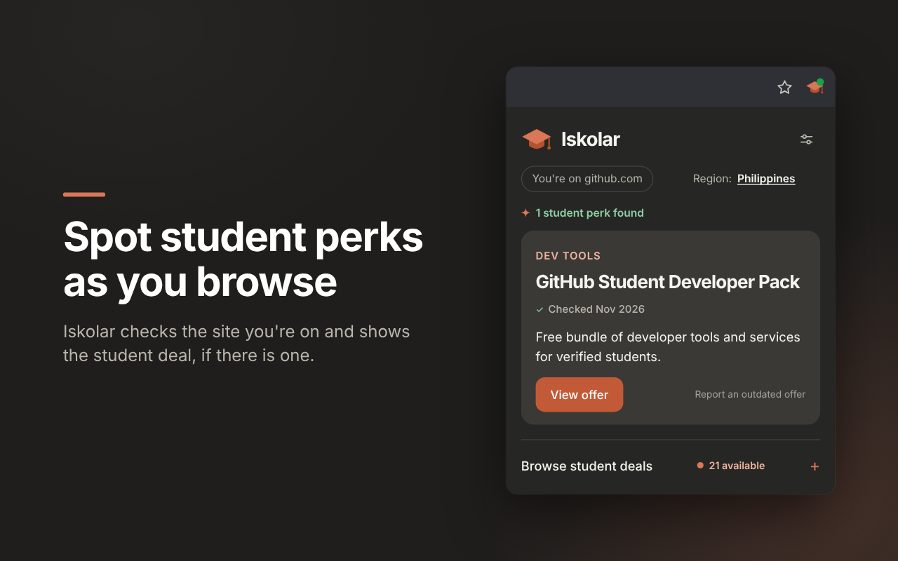
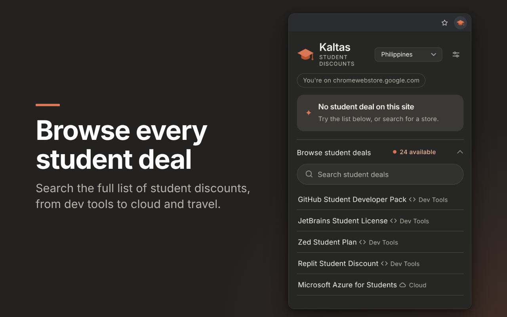

<div align="center">
  
  <h1>Iskolar</h1>
  <p>A privacy-first Chrome extension that helps students find discounts and education perks on the website they are visiting.</p>
  <p>
    <a href="https://github.com/miconvr/iskolar">Source code</a> ·
    <a href="https://github.com/miconvr/iskolar/issues">Report an offer problem</a> ·
    <a href="PRIVACY.md">Privacy policy</a>
  </p>
</div>

Iskolar is built for students in the Philippines first, with support for global
offers. Click the extension icon on a website to see whether a student deal is
known for that site. The project uses the clean Iskolar PNG logo for the popup
and README, with high-resolution PNG assets for Chrome's extension icon sizes.

> **Important:** Iskolar is a guide, not a guarantee. Offers can change, have
> country restrictions, or require verification. Always confirm the current
> terms on the official offer page before purchasing.

## What it does

- Matches the current website locally against a curated offer list
- Shows a green dot on the toolbar icon when the site you are on has a student offer
- Shows eligibility requirements, details, caveats, and the last verification month
- Supports Philippines and Other countries region filters
- Opens in a dark theme by default, with a Light option in the settings panel
- Includes a settings panel with a Dark/Light switch and a Hide footer option
- Keeps the footer compact so offers stay front and center
- Includes an offline bundled offer list
- Opens only HTTPS offer links
- Lets users report an outdated offer through GitHub
- Does not collect browsing history, page content, accounts, or analytics

## Screenshots

The popup is designed to keep offer matching local, clear, and easy to scan.

| Matched offer | Browse student deals | Private by design |
| --- | --- | --- |
|  |  |  |

These are also used as the Chrome Web Store listing screenshots.

## Install locally

### Requirements

- Google Chrome or another Chromium-based browser
- Git

### Setup

```bash
git clone https://github.com/miconvr/iskolar.git
cd iskolar
```

1. Open `chrome://extensions`.
2. Enable **Developer mode**.
3. Click **Load unpacked**.
4. Select the cloned `iskolar` folder.
5. Pin Iskolar and open it on a supported website.

After changing source files, return to `chrome://extensions` and click
**Reload** on Iskolar.

## How it works

```text
Current tab hostname
        |
        v
Local domain matching
        |
        v
Bundled offers.json
        |
        v
Student offer cards
```

The extension uses Manifest V3 and two permissions: `activeTab` for the popup
and `declarativeContent` for the toolbar badge. Offer matching and filtering
happen in the popup. A green dot appears on the toolbar icon when the current
site has a student offer: Chrome itself matches the page URL against rules built
from `offers.json`, so the extension never reads your tabs or history. The
extension ships with `offers.json` and does not download browsing data or a
changing remote offer list.

## Project files

| File | Purpose |
| --- | --- |
| `manifest.json` | Manifest V3 metadata, icons, and the `activeTab` and `declarativeContent` permissions |
| `background.js` | Service worker that adds the green toolbar badge on sites with an offer |
| `icons/logo.png` | High-resolution Iskolar logo used in the popup and README |
| `icons/logo.svg` | Scalable source artwork for future brand surfaces |
| `icons/icon16.png`, `icons/icon48.png`, `icons/icon128.png` | Chrome extension icon assets |
| `popup.html` | Popup shell |
| `popup.css` | Popup layout, dark and light themes, and accessibility states |
| `popup.js` | Host matching, region filtering, settings, rendering, and safe links |
| `offers.json` | Curated student-offer source of truth |
| `offers-loader.js` | Loads and validates the bundled offer list |
| `scripts/validate-offers.js` | Validates offer shape and HTTPS URLs |
| `store-assets/` | Chrome Web Store screenshots (1280x800) and promo tiles, also used in the README |
| `api/offer-assistant.js` | Optional Vercel and Gemini companion endpoint |
| `PRIVACY.md` | Extension privacy policy |

## Adding or updating an offer

Only add an offer after checking an official source. Keep the text generic so
rotating prices, promo codes, and temporary gifts do not become stale.

```json
{
  "name": "Example Student Plan",
  "domains": ["example.com"],
  "regions": ["global"],
  "category": "Productivity",
  "perk": "Discounted plan for verified students.",
  "url": "https://www.example.com/students",
  "details": "Explain the official eligibility process.",
  "requirements": "Describe who qualifies.",
  "caveats": "Mention country, renewal, or verification limits.",
  "verified": "YYYY-MM"
}
```

For an information-only entry, use `"type": "info"`, an empty `domains` array,
and omit `url`. Run the validator before opening a pull request:

```bash
node scripts/validate-offers.js
```

Every offer update must be reviewed before it is released. The bundled list is
the release source of truth, so data changes require a new extension release.

## Optional AI assistant

The extension does not contain an AI key and does not require the AI assistant.
The optional [Vercel function](api/offer-assistant.js) can explain an existing
curated offer using Google Gemini.

It is intentionally limited. It must not discover, verify, invent, or publish
discounts. If deployed, it receives only the student's question and the
selected offer text.

Configure these Vercel environment variables:

```dotenv
GEMINI_API_KEY=
GEMINI_MODEL=gemini-2.0-flash
```

Before connecting it to the extension, add rate limiting, usage limits, and a
deployed endpoint URL. Never commit an API key.

## Trust and review workflow

Automation may flag broken URLs or pages that changed, but it should not
automatically publish student discounts:

```text
Scheduled source check
        -> proposed change or issue
        -> official-page review
        -> pull request
        -> updated offers.json
        -> extension release
```

If an offer looks outdated, use the report link in the popup or open an issue
with the official source and the reason it needs review.

## Privacy

Iskolar compares the current tab hostname with local data after the user opens
the popup. It does not collect browsing history, page content, accounts, or
analytics. Your theme and footer choices stay on your device. Read the full
[privacy policy](PRIVACY.md).

## Open source

Iskolar is open source under the MIT License. Anyone can inspect the code,
install it locally, fork it, or deploy the optional companion endpoint.
Contributions are welcome, but offer data still needs an official source and
human review before it is merged.

## Development checks

```bash
node --check popup.js
node --check offers-loader.js
node scripts/validate-offers.js
```

## License

The code is available under the [MIT License](LICENSE).
